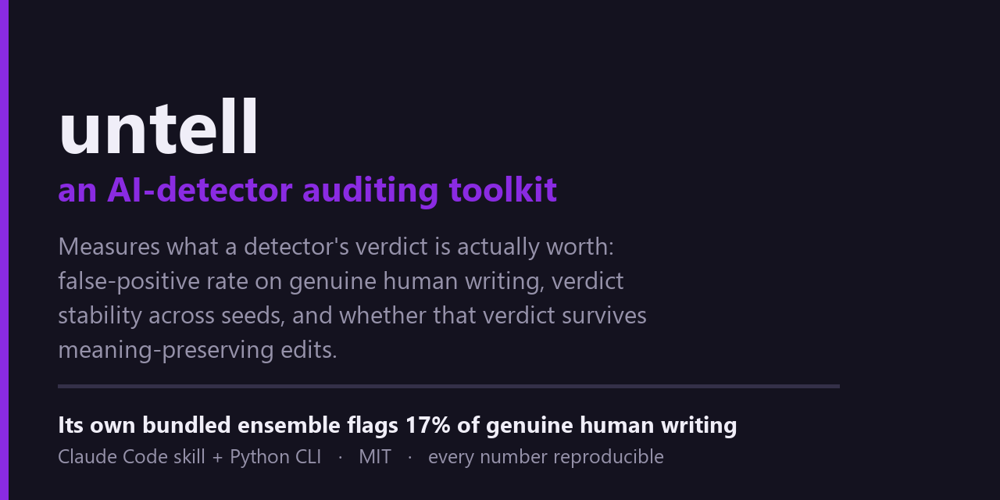

<div align="center">

<a href="https://ssamba1.github.io/untell/"></a>

# untell

### What is an AI detector's verdict worth?

An open-source toolkit for testing AI-text detectors: how often they call human writing
machine-made, whether a verdict on a given document is a stable property of its words, and what a
flag actually implies once the error rate and the base rate are counted.

[](https://github.com/ssamba1/untell/actions/workflows/ci.yml)
[](LICENSE)
[](https://www.python.org/)
[](#install)
[](https://ssamba1.github.io/untell/)

**[Evidence kit in your browser](https://ssamba1.github.io/untell/brief.html)** · [**Report: what a verdict is worth (Nov 2026)**](docs/report-2026-11.md) · [Auditing guide](docs/auditing.md) · [Observatory](docs/observatory/README.md) · [Measurement log](docs/free-ceiling-measured.md) · [Full reference](docs/reference.md)

</div>

---

## Why this exists

Detector scores are being used to accuse people of misconduct. As reported in February 2026, Washington State
University cancelled Turnitin's AI detection after finding that a third of its AI-misconduct cases
were dismissed when the detector was the only evidence
([memo](https://provost.wsu.edu/documents/2026/02/cancellation-of-turnitin-ai-detection-software_memo-to-instructors_provost-office_spring-2026.pdf)).
Waterloo, Curtin and the University of New England have switched AI detection off, and a student
won a lawsuit against Adelphi after a 100% Turnitin score.

The question a flagged student, their advisor, an integrity panel or a procurement team needs
answered is not "is this AI?". It is **"how much should anyone trust this number?"** — and nobody
publishes that, per document, per detector version, per kind of writer. untell measures it.

## What it does

**An evidence brief for one verdict on one document.** Re-scores the document under edits that
change *no words* — quote style, spacing after full stops, line wrapping, invisible characters —
and reports whether the verdict moves. A verdict that changes when only the typography changes is
not a statement about who wrote the words. The brief adds the detector's published error rates
(each cited, with how far we verified it), what a flag implies by Bayes' rule, the per-person risk
for someone who submitted many documents, and the questions to ask before relying on the score.
It contains the document's SHA-256, never its text.

```bash
untell brief --file essay.txt --detector gptzero --documents 12          # a detector with an API
untell variants --file essay.txt --out kit                                # Turnitin / any web UI:
untell brief --file essay.txt --detector manual:kit/scores.csv --name turnitin   # score by hand, then brief
```

The same test runs **offline in a browser** — [docs/brief.html](https://ssamba1.github.io/untell/brief.html):
paste the text, copy each variant into the detector, record the scores, print the brief. Nothing
is uploaded.

**A report card for a detector over a corpus.** False-positive rate by slice (writer group,
length) with 95% intervals, per-writer rollups, verdict stability, and recall at a capped
false-positive rate. Dated, versioned and fingerprinted, so `untell drift` can show when a vendor
silently changes its model.

```bash
untell report-card --detector pangram --human our-students.jsonl --ai samples.jsonl --json-out card.json
untell drift last-term.json card.json
```

**Human text you can prove is human.** `untell capsule` extracts prose from a git repository as
it stood before ChatGPT's release (2022-11-30), with the commit and date on every document, so
the "human" label rests on a timestamp rather than on trust.

**The arithmetic of an accusation.**

```text
$ untell flagmath --detector turnitin --documents 30
false-positive rate 0.0100 (Turnitin, 'Understanding false positives within our AI writing
detection capabilities'); true-positive rate assumed 0.90

if this share is AI-written   P(AI | flagged)   P(human | flagged)
     1.0%                      47.6%              52.4%
     5.0%                      82.6%              17.4%
    10.0%                      90.9%               9.1%
    ...
documents per honest writer   P(>=1 false flag)   flagged per 1000
     1                           1.0%                10
    30                          26.0%               260
    ...
```

Even taking the vendor's own figure at face value, about one honest student in four is flagged at
least once over 30 essays.

## What we have measured

| finding | figure | source |
|---|---|---|
| Seven commercial detectors (2023 versions) on non-native writers | flagged **52–76%** of TOEFL essays by non-native writers, **0–12%** of US 8th-graders' essays; untell reproduces the original study's 61% average (62.0%) | [observatory](docs/observatory/README.md), from [Liang et al.'s recorded scores](https://github.com/Weixin-Liang/ChatGPT-Detector-Bias) |
| The same detector, same threshold, different writing | lite tier: **1.2%** false positives on 80 pre-2022 PEPs, **30%** on HC3 forum answers | [observatory](docs/observatory/README.md), [Result 43](docs/free-ceiling-measured.md) |
| untell's own full ensemble, audited by itself — then fixed | its verdict flagged **57%** of 394 human essays (**92%** of TOEFL essays by non-native writers) and 49–73% of every race group in a US student corpus. Recalibrated on held-out pre-2022 text: TOEFL **20%**, US students **3–7%** across race groups, PEPs 0% — at the cost of AI recall falling from 91% to 45% | [calibration](docs/observatory/calibration.md) |
| The most-installed open detectors | Desklib (most downloaded) and Fakespot separate AI from human well (AUROC 0.984) yet at their default flag **53%** and **66%** of TOEFL essays and **51%** / **100%** of Stanford students' abstracts; ModernBERT flags none of either and catches 20% of AI text | [leaderboard](docs/observatory/open-detectors.md) |
| Recall on a 2024 model's essays reorders the detectors | Desklib and Fakespot catch **60/60** — the two that flag 53–66% of TOEFL essays. ModernBERT catches **67%** with **0%** TOEFL flagged; untell's calibrated verdict **15–17%** (45% on GPT-3); OpenAI RoBERTa **0%** | [modern-LLM recall](docs/observatory/modern-llm.md) |
| One invisible character decides an open detector | on short text, one **trailing space** reversed **every** "AI" verdict `hc3_roberta` gave: 36/36 flagged TOEFL essays and 88/88 flagged GPT-3 abstracts; AUROC 0.78 → 0.33 | [observatory](docs/observatory/trailing-space.md) |
| A detector read punctuation spacing as authorship | one space before each full stop took `hc3_roberta`'s AUROC from **0.98 to 0.14** — below chance | [`untell/detectors/base.py`](untell/detectors/base.py) |
| Text pasted from a justified PDF | soft hyphens made a human paragraph score **1.0000** AI | [`untell/detectors/base.py`](untell/detectors/base.py) |
| Optimising against detectors does not transfer | a detector-in-the-loop rewrite moved the detectors it saw and **not** one it never saw: 4/10 still flagged, every seed | [measurement log](docs/free-ceiling-measured.md) |

The punctuation and PDF rows are why untell normalises its own detectors' input, and why the
stability test exists: if the detectors in this repository had shortcuts like these, the commercial
ones may too, and the only way to know is to test them. **No commercial detector's current version
has been measured live here yet** — the 2023 figures above come from scores recorded at the time,
and the [observatory workflow](.github/workflows/observatory.yml) measures each current version as
soon as its API key is configured. For a non-native writer, `untell brief --writer non-native`
uses the population-specific rates.

## Install

```bash
git clone https://github.com/ssamba1/untell && cd untell
pip install -e .                 # the audit commands need nothing else
pip install -e ".[commercial]"   # + HTTP clients for GPTZero, Pangram, Originality, Copyleaks, ...
pip install -e ".[full]"         # + untell's own local detector ensemble (torch, CPU is fine)
```

`pip install untell` lands with the first PyPI release. Commercial detectors read their keys from
the environment (`GPTZERO_API_KEY`, `PANGRAM_API_KEY`, `ORIGINALITY_API_KEY`, …; full list in the
[reference](docs/reference.md)).

**Surfaces:** the `untell` CLI · a Claude Code skill (`/plugin marketplace add ssamba1/untell`,
then `/untell`) · an MCP server (`untell-mcp`: `brief`, `stability`, `variants`, `flagmath`, …) ·
a REST API (`untell-server`: `POST /brief`, `/stability`, `/variants`) · the offline browser kit.
Over MCP and HTTP the `cmd:` and `manual:` detector specs are refused, and commercial detectors
need the operator's opt-in (`UNTELL_API_ALLOW_COMMERCIAL=1`), because they spend API credit.

## Detectors

| kind | detectors | needs |
|---|---|---|
| commercial | GPTZero, Pangram, Originality.ai, Copyleaks, Winston, Sapling, ZeroGPT, an LLM judge | the provider's API key |
| any other | `cmd:<command>` — text on stdin, score on stdout | a script or CLI that calls it |
| no API at all (Turnitin, web UIs) | `manual:<scores.csv>` — scores recorded by hand per variant | a person and the variants kit |
| untell's own | `local` (RoBERTa ×2, MAGE, Fast-DetectGPT, perplexity), `local:lite` (stdlib) | `.[full]` for `local` |

## The robustness probe

untell also contains a **detector-in-the-loop rewriter** (`untell probe`, formerly `humanize`):
it rewrites text under a mechanical meaning gate — citations are locked; numerals, negation, hedges
and semantic roles are checked — and re-scores until the detector clears or the budget runs out. It exists
to measure whether a detector's verdict survives meaning-preserving editing, and its headline
result is a negative one: it moves the detectors it optimises against and does not move one it has
never seen. [Full documentation](docs/reference.md).

It is not supported for presenting machine-written work as your own where that is prohibited, and
it is measured to be ineffective for it.

## Limits, plainly

- **The test cannot prove authorship either way.** A verdict that flips under null edits is
  unreliable; a verdict that holds is only one that this test could not break.
- **Published rates describe the version and text that were tested.** Several entries in the
  rate table were seen only through secondary summaries and are marked so
  ([`published_rates.json`](untell/evidence/published_rates.json)).
- **The observatory corpus is one register** (technical proposals by experienced writers). It
  detects drift cheaply; it does not stand in for audits on student essays, non-native writers or
  short text — run `report-card` on those.
- **Check a vendor's terms of service before benchmarking it** ([auditing guide](docs/auditing.md)).
- Nothing here is legal advice.

## Contributing

The most valuable contributions are corpora with clear provenance (especially non-native and
student writing, with consent), report cards for detectors we cannot access, and corrections to the
[published-rates table](untell/evidence/published_rates.json). See [CONTRIBUTING.md](CONTRIBUTING.md).
Every documented number in this repository is re-checked by `untell-audit` in CI.

MIT licensed. Cite as described in [CITATION.cff](CITATION.cff).
